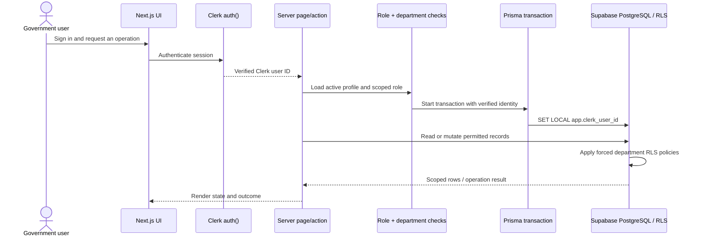

# Architecture

## Status and intent

This describes a working prototype, not a production government deployment design. The selected stack is Next.js, Prisma ORM, Supabase PostgreSQL, Clerk authentication, and Biome. The road workflow supports scoped registration, review/return, correction/resubmission, inspection findings, maintenance work, completion review, and attributed history. The dashboard displays department context and synthetic demo data. Migration 005 is applied; the project owner's inspection confirms all 15 application tables have forced RLS and the runtime connection uses `pravi_app` with `BYPASSRLS` disabled. Cross-department allow/deny behavior still needs a two-department integration check. Evidence file upload and Vercel deployment are not complete. Redis/Upstash is deferred; TanStack packages are not selected.

The design supports several asset categories with distinct real-world workflows. It starts with the road-segment vertical slice after the application, schema, and authentication foundation. Other asset types are added sequentially after that slice is complete.

## System context

```mermaid
flowchart LR
  subgraph Users[Government workforce]
    U1[Submitter]
    U2[Verifier]
    U3[Inspector]
    U4[Maintenance officer]
    U5[Planner / read-only]
    U6[Administrator]
  end

  subgraph Hosting[Vercel deployment target]
    Browser[Browser UI\nNext.js pages and components]
    Middleware[Clerk middleware\nRoute protection]
    Server[Next.js server pages\nServer actions]
    AuthZ[Authorization and workflow policies\nProfile + department + role checks]
    DbContext[Transaction identity context\nset app.clerk_user_id from Clerk auth()]
    Prisma[Prisma ORM\nPostgreSQL adapter]
  end

  Clerk[Clerk\nAuthentication + user identity]
  subgraph Supabase[Supabase PostgreSQL]
    Runtime[pravi_app runtime role\nNO BYPASSRLS]
    RLS[Forced RLS on 15 application tables\nDepartment-scoped policies]
    Schema[(pravi schema\nProfiles · Departments · Roles\nAssets · Inspections · Work orders\nEvidence metadata · Append-only events)]
    Admin[postgres admin role\nMigrations + seed only]
    Ledger[(public._prisma_migrations)]
  end
  Storage[Private evidence object storage\nPlanned; upload not implemented]

  Users --> Browser
  Browser --> Middleware
  Middleware <--> Clerk
  Browser --> Server
  Server --> AuthZ
  AuthZ --> DbContext
  DbContext --> Prisma
  Prisma -->|DATABASE_URL| Runtime
  Runtime --> RLS
  RLS --> Schema
  Admin -. DIRECT_URL for admin tasks .-> Schema
  Admin -. migration ledger .-> Ledger
  Server -. planned evidence upload .-> Storage
```

### Request and authorization sequence



Clerk authenticates a person. The application maps the authenticated identity to application-managed role and jurisdiction assignments. Every protected read and mutation must enforce those assignments server-side; hiding a button in the UI is not authorization. The prototype grants access only to the exact department on a role assignment; parent department membership does not automatically grant child-jurisdiction access.

## Application boundaries

- **Presentation:** Next.js pages and components present role-appropriate tasks and records. UI state is not authoritative for permissions or lifecycle state.
- **Application logic:** server-side operations validate input, establish actor and scope, enforce authorization, apply allowed workflow transitions, and create history/audit records transactionally where appropriate.
- **Identity and authorization:** Clerk provides authentication. Local application data records roles and department/jurisdiction scopes; exact provisioning and government identity integration are open questions.
- **Persistence:** Prisma accesses Supabase PostgreSQL. Schema changes are versioned through migrations. Keep stable, frequently queried concepts relational; use type-specific extension data only where it provides a clear benefit.
- **Evidence:** store file binaries in private object storage, with metadata and references in PostgreSQL. Provider, retention, and access policy remain undecided.
- **Localization:** use `next-intl` message catalogs for the initial English, Hindi, Bengali, Marathi, and Gujarati UI. A cookie carries the authenticated user's locale preference while URLs remain stable. Translate interface labels, validation, and workflow-state labels; keep identifiers, database values, and submitted record content unchanged. Fluent review is required before government use.
- **Caching:** no cache layer initially. Evaluate Redis/Upstash only when a concrete need and invalidation strategy are known. TanStack libraries may be evaluated for a specific client-side need, but no package is selected.

## Initial domain concepts

The current schema is a **road-first prototype foundation**, not a completed all-asset or full-lifecycle implementation. The shared asset contract has common id, category, name, optional latitude/longitude representative location, owning department, status, lifecycle stage, and creation time. Shared lifecycle stages support cross-category reporting; the road segment has a separate workflow status and actor-attributed status history. Transfer/decommission event vocabulary exists, but those workflows are not implemented. For current tables, relationships, remaining gaps, and verification status, see [DATABASE_SCHEMA_REVIEW.md](DATABASE_SCHEMA_REVIEW.md). The broader concepts below remain design direction unless explicitly implemented.

The conceptual model should grow from the road slice rather than pre-building a generalized engine:

- Asset identity, category, owner/department, jurisdiction, location/geometry, and current operational/condition projection.
- Road segment details such as route reference, segment boundaries/chainage, surface, and provenance, subject to source data confirmation.
- User role/scope assignments separate from Clerk authentication identity.
- Submission/verification decisions with actor, timestamp, outcome, and reason. Road workflow status history is category-specific; shared lifecycle stage changes are represented on lifecycle events.
- Inspection records and findings with assessment date, inspector, condition, evidence references, and review status.
- Work request/order with affected segment or defined sub-section, priority, assignment, dates, status, completion notes, and evidence references.
- Append-oriented lifecycle/audit history for consequential changes. Current state is a convenient projection, not a replacement for history.
- Evidence metadata in the database; file content remains outside the database.

Future asset types may need distinct attributes, inspection templates, components, and lifecycle transitions. Add those when implementing each next slice rather than forcing roads, bridges, buildings, and water assets into one premature workflow model.

## Road-segment request flow

1. A submitter authenticates and creates a road-segment submission with the fields currently supported by the prototype. Evidence metadata is modeled, but the file-upload flow is not implemented.
2. Server-side logic checks role and jurisdiction scope, validates the payload, and records the submission event.
3. A verifier reviews the submission and approves it or returns it with a reason. The decision is preserved in history.
4. An inspector records a condition assessment and structured findings. A verifier may return the inspection; its assigned inspector can correct and resubmit it while preserving the earlier payload snapshot.
5. A maintenance officer creates a work order and assigns an active maintenance officer in the same department. Completion notes are required, and a verifier records the completion decision.
6. A read-only planner views the asset summary, condition, open work, and lifecycle history.

This flow is a prototype assumption. Official process rules, required evidence, condition scales, timing, and approval authorities must be confirmed with Pravi/government representatives.

## Security and operational principles

- Keep secrets in environment settings, not the repository, README, or ZIP deliverable.
- Use synthetic demonstration data; do not seed real personal or sensitive government data.
- Enforce least privilege by role and jurisdiction at server-side data boundaries.
- Validate uploads and restrict evidence access; exact storage and retention controls remain to be selected.
- Preserve reasons and prior decisions when a submission is returned or changed.
- Retire assets and deactivate accounts/role assignments rather than hard-deleting records with operational history.
- Do not claim production readiness, offline support, or government-system integration unless implemented and validated.

## Open architecture questions

- How are departments and jurisdiction hierarchies represented, and can users span them?
- What identity provisioning and account lifecycle should be used for government personnel?
- Which evidence storage service, file limits, retention, and access controls are required?
- What GIS/geometry format and authoritative road data sources are required?
- Are offline field capture and synchronization needed?
- What audit export, retention, availability, and security requirements apply?
- Which parts of a road need separate identity when a segment is split, merged, or partially maintained?

## Deployment direction

Vercel is the target application host and Supabase PostgreSQL is the selected database host. Configure the project’s environment variables in each deployment environment. Use the direct database URL for migrations where required by Prisma/Supabase setup and the pooled URL for runtime where suitable. The exact production topology, backup, monitoring, and access policy are outside the current prototype architecture and require confirmation.

## Database schema isolation and RLS status

Application-owned Prisma models and enums are being moved to the `pravi` PostgreSQL schema; Prisma migration history remains in `public` to preserve the existing migration ledger. Keep `pravi` out of Supabase Data API exposed schemas unless a deliberate API is designed. The migration revokes schema access from `PUBLIC`, `anon`, and `authenticated` where those roles exist.

The fifth migration creates the `pravi_app` non-owner role, least-privilege grants, append-only history permissions, and department-scoped RLS policies on all 15 Prisma models. It forces RLS and uses a transaction-local Clerk identity set only from server-verified auth. The project's latest inspection confirms runtime `pravi_app`, `BYPASSRLS=false`, and RLS enabled/forced on all 15 tables. Cross-department behavior has not yet been integration-tested. Clerk checks stay in place as defense in depth. See [SECURITY.md](SECURITY.md) for rollout and validation.
