# Comprehensive Code Review & Bug Analysis

**Project:** Pravi Infrastructure Assets  
**Date:** September 28, 2026  
**Scope:** Architecture, Workflow State Machines, Authorization, Linter/Biome Compliance, Database & Build Tooling  
**Reference Documents:** [Decision.md](file:///c:/Harsh/Privet%20Folder/Project/Pravi/Decision.md), [ARCHITECTURE.md](file:///c:/Harsh/Privet%20Folder/Project/Pravi/ARCHITECTURE.md), [PRODUCT_BRIEF.md](file:///c:/Harsh/Privet%20Folder/Project/Pravi/PRODUCT_BRIEF.md), [DATABASE_SCHEMA_REVIEW.md](file:///c:/Harsh/Privet%20Folder/Project/Pravi/DATABASE_SCHEMA_REVIEW.md)

> The findings in sections 1–7 record the code as it stood during the review. Section 8 tracks the remediation pass that followed; unresolved scope limits are listed there.

---

## Executive Summary

A comprehensive automated and manual code audit was conducted on the Pravi codebase. The application represents a well-structured Next.js 15, Prisma ORM, and Clerk prototype implementing the road-segment slice. The core database schema and TypeScript compilation pass cleanly (`tsc --noEmit` exited with 0 errors).

However, the audit identified several **critical workflow bugs, dead-end states, active Biome linter/accessibility errors, build/environment configuration mismatches, branding regressions, and architectural inconsistencies** that require remediation before production or deployment readiness.

### Summary of Findings by Severity

| Severity | Count | Summary of Issues |
|---|---|---|
| **Critical** | 3 | Dead-end inspection review state (`NEEDS_CHANGES`), permanent lifecycle freeze on work-order completion, Prisma CLI environment variable failure (`DIRECT_URL` / `.env.local` mismatch) |
| **High** | 4 | Missing inspection findings creation pipeline, road registration self-approval loophole, missing work order completion notes requirement, dead mock dashboard disconnected from real asset data |
| **Medium** | 4 | Active Biome linter & accessibility check failures (3 errors, 2 warnings), unused core auth functions with duplicated ad-hoc checks, redundant dynamic imports & repeated user profile queries, UI artifact displaying redundant `Maintenance Repair → Maintenance Repair` |
| **Low / Polish** | 3 | Branding regression ("CivicWorks" instead of "Pravi" in dashboard), hardcoded self-assignment on work orders, unimplemented evidence upload pipeline |

---

## 1. Active Linter & Accessibility Violations (Biome Check)

Running `npm run lint` (`biome check .`) fails with **3 errors and 2 warnings**:

```text
Checked 22 files in 198ms. No fixes applied.
Found 3 errors.
Found 2 warnings.
```

### 1.1. Disallowed `!important` in CSS Reset
- **File:** [src/components/dashboard-overview.module.css:1315-1316](file:///c:/Harsh/Privet%20Folder/Project/Pravi/src/components/dashboard-overview.module.css#L1315-L1316)
- **Rule:** `lint/complexity/noImportantStyles`
- **Issue:** Under `@media (prefers-reduced-motion: reduce)`, `scroll-behavior: auto !important;` and `transition: none !important;` are flagged.
- **Remediation:** Remove `!important` or configure the reduced-motion rule specificity cleanly without cascade reversal, or disable the rule selectively for CSS reset rules.

### 1.2. Accessibility: Non-Semantic Element with `role="status"`
- **File:** [src/app/dashboard/page.tsx:60](file:///c:/Harsh/Privet%20Folder/Project/Pravi/src/app/dashboard/page.tsx#L60)
- **Rule:** `lint/a11y/useSemanticElements`
- **Issue:** 
  ```tsx
  <div className="demo-data-banner" role="status">
    Prototype workspace · synthetic demonstration data
  </div>
  ```
- **Remediation:** Replace `<div ... role="status">` with semantic `<output className="demo-data-banner">`.

### 1.3. Unsorted Imports (Biome Assist Failures)
- **File:** [src/app/layout.tsx:1](file:///c:/Harsh/Privet%20Folder/Project/Pravi/src/app/layout.tsx#L1)
- **File:** [src/app/page.tsx:1](file:///c:/Harsh/Privet%20Folder/Project/Pravi/src/app/page.tsx#L1)
- **Rule:** `assist/source/organizeImports`
- **Remediation:** Sort imports alphabetically to satisfy Biome import organization rules (`@clerk/nextjs` before `next`).

---

## 2. Critical Workflow & State Machine Bugs

### 2.1. Dead-End Inspection Review Workflow (`NEEDS_CHANGES`)
- **Severity:** Critical
- **Files:** 
  - [src/app/assets/actions.ts:602-609](file:///c:/Harsh/Privet%20Folder/Project/Pravi/src/app/assets/actions.ts#L602-L609)
  - [src/app/assets/[id]/page.tsx:320-325](file:///c:/Harsh/Privet%20Folder/Project/Pravi/src/app/assets/%5Bid%5D/page.tsx#L320-L325)
  - [src/app/assets/asset-forms.tsx](file:///c:/Harsh/Privet%20Folder/Project/Pravi/src/app/assets/asset-forms.tsx)
- **Bug Description:**
  In `reviewInspection()`, a department verifier can approve (`verify`) or return (`return`) an inspection:
  ```ts
  const nextStatus = decision === "verify" 
    ? InspectionStatus.VERIFIED 
    : InspectionStatus.NEEDS_CHANGES;
  ```
  When returned, the inspection's status is set to `NEEDS_CHANGES`. However:
  1. There is **no server action** (e.g. `correctInspection` or `resubmitInspection`) in `actions.ts`.
  2. There is **no correction form** in `asset-forms.tsx`.
  3. In `src/app/assets/[id]/page.tsx`, the review form only renders when `inspection.status === "SUBMITTED"`.
- **Consequence:** An inspection returned for changes is permanently locked in a dead-end state. The inspector cannot update or resubmit it, and the verifier cannot re-review it.
- **Fix:** Implement `correctInspection` action, add `InspectionCorrectionForm`, and render it when `inspection.status === "NEEDS_CHANGES"` for the assigned inspector or admin.

---

### 2.2. Incomplete Lifecycle Transition: Asset Frozen at `MAINTENANCE_REPAIR`
- **Severity:** Critical
- **Files:** 
  - [src/app/assets/actions.ts:728-732](file:///c:/Harsh/Privet%20Folder/Project/Pravi/src/app/assets/actions.ts#L728-L732)
  - [src/app/assets/actions.ts:835-874](file:///c:/Harsh/Privet%20Folder/Project/Pravi/src/app/assets/actions.ts#L835-L874)
- **Bug Description:**
  When a work order is created, the asset's shared `lifecycleStage` transitions to `MAINTENANCE_REPAIR`:
  ```ts
  await transaction.asset.update({
    where: { id: assetId },
    data: { lifecycleStage: LifecycleStage.MAINTENANCE_REPAIR },
  });
  ```
  When the work order is subsequently updated through `changeWorkOrderStatus()` to `COMPLETED`, `VERIFIED`, or `CANCELLED`:
  ```ts
  // Line 864-865 in actions.ts:
  fromStage: asset.lifecycleStage,
  toStage: asset.lifecycleStage,
  ```
  The asset's `lifecycleStage` is **never updated** on completion or verification.
- **Consequence:** Once any maintenance work order is opened, the asset remains permanently labeled as `MAINTENANCE_REPAIR` in registry reports and detail views, even after work is successfully verified or cancelled.
- **Fix:** On work order verification (`VERIFIED`) or cancellation (`CANCELLED` when no other active work orders exist), evaluate whether other open work orders exist; if none exist, transition `asset.lifecycleStage` back to `OWNERSHIP_LOCATION_ASSIGNMENT` or `CONDITION_RISK_ASSESSMENT`.

---

### 2.3. Missing Inspection Findings Data Entry Pipeline
- **Severity:** High
- **Files:** 
  - [prisma/schema.prisma:280-293](file:///c:/Harsh/Privet%20Folder/Project/Pravi/prisma/schema.prisma#L280-L293)
  - [src/app/assets/actions.ts:514-558](file:///c:/Harsh/Privet%20Folder/Project/Pravi/src/app/assets/actions.ts#L514-L558)
  - [src/app/assets/asset-forms.tsx:400-432](file:///c:/Harsh/Privet%20Folder/Project/Pravi/src/app/assets/asset-forms.tsx#L400-L432)
- **Bug Description:**
  The Prisma schema models `InspectionFinding` with rich attributes (`category`, `severity`, `description`, `recommendedAction`, `startMarker`, `endMarker`). The asset detail page has code ready to render findings:
  ```tsx
  {inspection.findings.map((finding) => (
    <p key={finding.id} className={styles.muted}>
      {label(finding.severity)} · {finding.description}
    </p>
  ))}
  ```
  However, `InspectionForm` only takes `condition` and `notes`. The server action `recordInspection` does not accept or persist findings.
- **Consequence:** Inspectors cannot log concrete defects (e.g. potholes, surface cracks, edge failures). Findings remain entirely unreachable from the application.
- **Fix:** Extend `InspectionForm` and `recordInspection` to accept optional finding items (category, severity, description, marker extent).

---

### 2.4. Separation of Duties Asymmetry: Submitter Can Approve Own Road Segment
- **Severity:** High
- **Files:** 
  - [src/app/assets/actions.ts:251-265](file:///c:/Harsh/Privet%20Folder/Project/Pravi/src/app/assets/actions.ts#L251-L265)
  - [src/app/assets/actions.ts:585-597](file:///c:/Harsh/Privet%20Folder/Project/Pravi/src/app/assets/actions.ts#L585-L597)
- **Bug Description:**
  In `reviewInspection()`, self-review is explicitly prevented:
  ```ts
  if (inspection.inspectorId === profile.id) {
    return { error: "A different verifier with department access must review this inspection." };
  }
  ```
  In `reviewRoadSegment()`, however, there is **no check** verifying `asset.createdById !== profile.id`.
- **Consequence:** A user with both submitter and verifier role assignments (or an admin) can register a road segment and immediately approve their own record without independent review.
- **Fix:** Enforce `if (asset.createdById === profile.id && !hasDepartmentRole(profile, asset.departmentId, ["ADMIN"]))` check in `reviewRoadSegment()` or require a distinct verifier ID.

---

### 2.5. Permissive Work Order Completion Without Notes
- **Severity:** High
- **Files:** 
  - [src/app/assets/actions.ts:815-833](file:///c:/Harsh/Privet%20Folder/Project/Pravi/src/app/assets/actions.ts#L815-L833)
  - [src/app/assets/asset-forms.tsx:542-549](file:///c:/Harsh/Privet%20Folder/Project/Pravi/src/app/assets/asset-forms.tsx#L542-L549)
- **Bug Description:**
  `changeWorkOrderStatus()` checks:
  ```ts
  if ((requestedStatus === WorkOrderStatus.VERIFIED || requestedStatus === WorkOrderStatus.CANCELLED) && !reason) {
    return { error: "A reason is required for a terminal work-order transition." };
  }
  ```
  `COMPLETED` is omitted from this check. The placeholder in the UI says `"Required when verifying or cancelling"`. If left blank, `actualEnd` is recorded but `completionNotes` is stored as `null`.
- **Consequence:** Maintenance officers can mark work orders complete with zero notes detailing the actual work performed, materials used, or repairs conducted.
- **Fix:** Require `reason` / completion notes when `requestedStatus === WorkOrderStatus.COMPLETED`.

---

## 3. Configuration, Environment & Tooling Issues

### 3.1. Prisma CLI Does Not Read `.env.local`
- **Severity:** Critical
- **Files:** 
  - [.env.local](file:///c:/Harsh/Privet%20Folder/Project/Pravi/.env.local)
  - [package.json:11-13](file:///c:/Harsh/Privet%20Folder/Project/Pravi/package.json#L11-L13)
  - [prisma/schema.prisma:7-8](file:///c:/Harsh/Privet%20Folder/Project/Pravi/prisma/schema.prisma#L7-L8)
- **Issue:**
  Next.js loads `.env.local` automatically at runtime, but the Prisma CLI (`npx prisma validate`, `npm run db:migrate`, `npm run db:generate`, `npm run db:seed`) only reads `.env` by default.
  Running `npx prisma validate` without pre-set shell environment variables fails immediately:
  ```text
  Error: Prisma schema validation - (get-config wasm)
  Error code: P1012
  error: Environment variable not found: DIRECT_URL.
  ```
- **Remediation:**
  1. Provide a symlink or `.env` file (gitignored) for CLI tooling, OR
  2. Update package.json scripts to use `dotenv-cli` or Node's `--env-file=.env.local` flag:
     ```json
     "db:migrate": "dotenv -e .env.local -- prisma migrate dev",
     "db:seed": "dotenv -e .env.local -- tsx prisma/seed.ts"
     ```

### 3.2. Deprecated `package.json#prisma` Configuration
- **Severity:** Medium
- **File:** [package.json:34-36](file:///c:/Harsh/Privet%20Folder/Project/Pravi/package.json#L34-L36)
- **Issue:**
  `package.json` contains:
  ```json
  "prisma": {
    "seed": "tsx prisma/seed.ts"
  }
  ```
  Prisma 6 emits: `warn The configuration property package.json#prisma is deprecated and will be removed in Prisma 7. Please migrate to a Prisma config file (e.g., prisma.config.ts).`
- **Remediation:** Create `prisma.config.ts` per Prisma 6/7 guidelines.

### 3.3. `seed.ts` Lacks Autonomous Environment Loading
- **Severity:** Medium
- **File:** [prisma/seed.ts:1](file:///c:/Harsh/Privet%20Folder/Project/Pravi/prisma/seed.ts#L1)
- **Issue:** `seed.ts` does not call `dotenv/config` or use `--env-file`. Running `npx prisma db seed` fails if `DATABASE_URL` is not already exported in the parent shell environment.
- **Remediation:** Add `import "dotenv/config";` or run with `--env-file=.env.local`.

---

## 4. Architectural & Code Quality Inconsistencies

### 4.1. Dead/Unused Core Auth Helpers & Re-implemented Checks
- **Severity:** Medium
- **Files:** 
  - [src/lib/auth.ts:45-69](file:///c:/Harsh/Privet%20Folder/Project/Pravi/src/lib/auth.ts#L45-L69)
  - [src/app/assets/actions.ts:52-71](file:///c:/Harsh/Privet%20Folder/Project/Pravi/src/app/assets/actions.ts#L52-L71)
  - [src/app/assets/page.tsx:55-57](file:///c:/Harsh/Privet%20Folder/Project/Pravi/src/app/assets/page.tsx#L55-L57)
  - [src/app/assets/[id]/page.tsx:108-116](file:///c:/Harsh/Privet%20Folder/Project/Pravi/src/app/assets/%5Bid%5D/page.tsx#L108-L116)
- **Issue:**
  `src/lib/auth.ts` exports `hasRole()` and `getRoleContext()`. **Neither function is imported anywhere in `src/`.**
  Instead:
  - `actions.ts` writes private helper functions `hasDepartmentRole()` and `canAccessDepartment()`.
  - `AssetsPage` writes `profile.roleAssignments.some(a => ["SUBMITTER", "ADMIN"].includes(a.role))`.
  - `AssetDetailPage` writes local closure `roleInDepartment()`.
- **Remediation:** Centralize authorization checks in `src/lib/auth.ts` and import them consistently across server actions and page components.

### 4.2. Redundant Dynamic Imports & Duplicate Profile Lookups
- **Severity:** Medium
- **Files:** 
  - [src/app/assets/page.tsx:14-27](file:///c:/Harsh/Privet%20Folder/Project/Pravi/src/app/assets/page.tsx#L14-L27)
  - [src/app/assets/new/page.tsx:15-25](file:///c:/Harsh/Privet%20Folder/Project/Pravi/src/app/assets/new/page.tsx#L15-L25)
  - [src/app/assets/[id]/page.tsx:38-43](file:///c:/Harsh/Privet%20Folder/Project/Pravi/src/app/assets/%5Bid%5D/page.tsx#L38-L43)
- **Issue:**
  `src/lib/auth.ts` defines `requireUserProfile()` which retrieves Clerk authentication and Prisma user profile with active role assignments.
  However, `AssetsPage`, `NewRoadSegmentPage`, and `AssetDetailPage` all use dynamic imports (`const { getPrisma } = await import("@/lib/prisma");`) and execute raw duplicate `prisma.userProfile.findUnique` queries.
- **Remediation:** Standardize all server components on `requireUserProfile()` from `src/lib/auth.ts`.

### 4.3. UI Glitch: Redundant Stage Transition History Display
- **Severity:** Medium
- **File:** [src/app/assets/[id]/page.tsx:427-432](file:///c:/Harsh/Privet%20Folder/Project/Pravi/src/app/assets/%5Bid%5D/page.tsx#L427-L432)
- **Issue:**
  ```tsx
  {(event.fromStage || event.toStage) && (
    <span>
      {event.fromStage ? label(event.fromStage) : "Start"} →{" "}
      {event.toStage ? label(event.toStage) : "—"}
    </span>
  )}
  ```
  When an event does not change the stage (such as work order status updates while in `MAINTENANCE_REPAIR`), `fromStage` and `toStage` are identical. The UI displays:
  `Maintenance Repair → Maintenance Repair`.
- **Remediation:** Only display the stage arrow if `event.fromStage !== event.toStage`.

---

## 5. UI / Presentation Discrepancies

### 5.1. Overview Dashboard Disconnected from Live Database
- **Severity:** High
- **Files:** 
  - [src/app/dashboard/page.tsx](file:///c:/Harsh/Privet%20Folder/Project/Pravi/src/app/dashboard/page.tsx)
  - [src/components/dashboard-overview.tsx:160-201](file:///c:/Harsh/Privet%20Folder/Project/Pravi/src/components/dashboard-overview.tsx#L160-L201)
  - [src/components/dashboard-overview.tsx:351-414](file:///c:/Harsh/Privet%20Folder/Project/Pravi/src/components/dashboard-overview.tsx#L351-L414)
- **Issue:**
  While the asset register (`/assets`, `/assets/new`, `/assets/[id]`) correctly reads and writes to Supabase PostgreSQL, the main dashboard (`/dashboard`) passes only user strings to `DashboardOverview`.
  All metrics ("1,284 segments", "12 awaiting verification", "28 inspections", "17 open work orders"), the verification queue ("Meadowbrook Extension", "Riverside"), condition graphs (58% good, 29% fair, 13% poor), and the recent asset table are hardcoded mock constants inside `dashboard-overview.tsx`.
- **Consequence:** Assets created or verified in `/assets` never show up on `/dashboard`. Users see an illusion of activity that has no connection to their database state.
- **Remediation:** Query real aggregate counts and recent assets from Prisma in `DashboardPage` and pass them into `DashboardOverview`.

### 5.2. Branding Regression: Leftover "CivicWorks" Name
- **Severity:** Low
- **File:** [src/components/dashboard-overview.tsx:227-238](file:///c:/Harsh/Privet%20Folder/Project/Pravi/src/components/dashboard-overview.tsx#L227-L238)
- **Issue:**
  In `dashboard-overview.tsx`:
  - Line 229: `aria-label="CivicWorks home"`
  - Line 237-238: `<span className={styles.brandText}>civic<span>works</span></span>`
  Every other file across the app uses **PRAVI** / **Pravi Public Asset Registry**.
- **Remediation:** Replace `civicworks` with `PRAVI`.

### 5.3. Inoperative Dashboard Controls
- **Severity:** Low
- **File:** [src/components/dashboard-overview.tsx](file:///c:/Harsh/Privet%20Folder/Project/Pravi/src/components/dashboard-overview.tsx)
- **Issue:**
  Numerous buttons and links on `/dashboard` are non-functional placeholders:
  - Top action search button and notifications bell (lines 312, 319)
  - "View map" button (line 343)
  - Verification desk links pointing to `#verification`, `#guide`, `#settings`
  - Table search input and "Filter" button (lines 590, 596)
  - Table row actions button (line 649)
  - Table pagination buttons (lines 668, 671)
- **Remediation:** Wire active links to existing routes (e.g. `/assets`) or visually indicate prototype status.

---

## 6. Security, Persistence & Evidence Gaps

### 6.1. Evidence Storage is Metadata-Only Without Object Store
- **Severity:** Medium
- **Files:** 
  - [prisma/schema.prisma:352-378](file:///c:/Harsh/Privet%20Folder/Project/Pravi/prisma/schema.prisma#L352-L378)
  - [src/app/assets/[id]/page.tsx:465-472](file:///c:/Harsh/Privet%20Folder/Project/Pravi/src/app/assets/%5Bid%5D/page.tsx#L465-L472)
- **Issue:**
  `Evidence` model is defined in the database, but no S3/Supabase Storage bucket integration exists. The asset detail page displays: `"File upload is not yet available in this prototype."`

### 6.2. Server Action Error Handling in Mutations
- **Severity:** Low
- **Files:** [src/app/assets/actions.ts:514](file:///c:/Harsh/Privet%20Folder/Project/Pravi/src/app/assets/actions.ts#L514), [709](file:///c:/Harsh/Privet%20Folder/Project/Pravi/src/app/assets/actions.ts#L709)
- **Issue:**
  `recordInspection()` and `createWorkOrder()` invoke `prisma.$transaction(...)` without a `try/catch` block. Any database failure (e.g. connection timeout, constraint violation) bubbles up as an unhandled server action error rather than returning `{ error: "..." }` to the client form.

---

## 7. Prioritized Remediation Roadmap

```mermaid
gantt
    title Remediation Roadmap
    dateFormat  X
    axisFormat %s

    section Phase 1 - CI & Tooling
    Fix Biome CSS !important rule            :active, p1_1, 0, 1
    Fix dashboard banner <output> a11y       :active, p1_2, 0, 1
    Organize imports in layout/page.tsx      :active, p1_3, 0, 1
    Fix CLI env loading (.env / dotenv)      :p1_4, 1, 2

    section Phase 2 - Critical Workflows
    Add Inspection Correction & Resubmission :p2_1, 2, 4
    Fix Lifecycle Stage freeze on Work Orders:p2_2, 3, 5
    Add Inspection Findings entry support    :p2_3, 4, 6
    Enforce self-approval check in review    :p2_4, 5, 6

    section Phase 3 - Data & Consistency
    Centralize auth helper usage             :p3_1, 6, 7
    Connect Dashboard metrics to Prisma      :p3_2, 7, 9
    Fix CivicWorks brand typo in Dashboard   :p3_3, 6, 7
```



### Action Items Checklist

1. [ ] **Resolve Biome Failures:**
   - Update [src/app/dashboard/page.tsx](file:///c:/Harsh/Privet%20Folder/Project/Pravi/src/app/dashboard/page.tsx#L60) to use `<output className="demo-data-banner">`.
   - In [src/components/dashboard-overview.module.css](file:///c:/Harsh/Privet%20Folder/Project/Pravi/src/components/dashboard-overview.module.css#L1315-L1316), resolve `!important` usage.
   - Run `npx biome check --write .` to auto-organize imports in `layout.tsx` and `page.tsx`.
2. [ ] **Fix Workflow Dead-Ends:**
   - Implement `correctInspection` action in [src/app/assets/actions.ts](file:///c:/Harsh/Privet%20Folder/Project/Pravi/src/app/assets/actions.ts).
   - Render `InspectionCorrectionForm` on [src/app/assets/[id]/page.tsx](file:///c:/Harsh/Privet%20Folder/Project/Pravi/src/app/assets/%5Bid%5D/page.tsx) when status is `NEEDS_CHANGES`.
   - Update `changeWorkOrderStatus` to restore `asset.lifecycleStage` once maintenance work is `VERIFIED` or `CANCELLED`.
3. [ ] **Correct Branding & UI Glitches:**
   - Change `civicworks` to `PRAVI` in [src/components/dashboard-overview.tsx](file:///c:/Harsh/Privet%20Folder/Project/Pravi/src/components/dashboard-overview.tsx#L237).
   - Update timeline display in [src/app/assets/[id]/page.tsx](file:///c:/Harsh/Privet%20Folder/Project/Pravi/src/app/assets/%5Bid%5D/page.tsx#L427) to only show transition arrows when `event.fromStage !== event.toStage`.
4. [ ] **Unify Auth Checks:**
   - Migrate ad-hoc checks in `actions.ts` and pages to utilize [src/lib/auth.ts](file:///c:/Harsh/Privet%20Folder/Project/Pravi/src/lib/auth.ts).

## 8. Remediation Status

**Updated September 28, 2026.** The following fixes were made after the findings above. These status notes supersede the as-found action checklist in section 7.

| Finding | Status | Remediation |
|---|---|---|
| Inspection findings entry | Resolved in prototype | Initial submission records structured findings. |
| Returned inspection dead end | Resolved in prototype | Assigned inspector or department admin can correct and resubmit; each submission payload is snapshotted in append-only `InspectionEvent.details`. A migration was added but not applied. |
| Work-order lifecycle freeze | Resolved in prototype | When verification or cancellation closes the last open work order, the asset stage returns to condition assessment or ownership/location assignment based on recorded condition. |
| Road self-approval | Resolved in prototype | The submitter cannot verify their own road submission, including when holding an administrator role. |
| Completion notes | Resolved in prototype | Completion, verification, and cancellation require a reason/notes value. |
| Dashboard mock data and controls | Resolved in prototype | Dashboard metrics and lists are Prisma-backed and department-scoped; nonfunctional controls and hash links were removed. Data can still be synthetic. |
| Dashboard brand/accessibility | Resolved | PRAVI branding and semantic `<output>` banner are used. |
| Biome errors and CSS `!important` | Resolved | Import order, formatting, and reduced-motion CSS were corrected. |
| Prisma CLI environment and deprecated seed config | Resolved | `prisma.config.ts` loads local env files and defines the seed command; `dotenv` is declared directly. |
| Duplicate profile lookups and ad-hoc auth checks | Resolved in main asset routes | Asset list, registration, dashboard, detail page, and server actions use centralized profile/role helpers. Authorization remains server-side. |
| Redundant lifecycle arrows | Resolved | Stage arrows render only when the stage changes. |
| Hardcoded work-order self-assignment | Resolved in prototype | Work order assignment selects an active maintenance officer in the same department; the action validates that role assignment server-side. |
| Evidence file storage | Deferred | Evidence metadata is modeled, but object storage, upload/download authorization, and retention are not implemented. |
| Migration treatment of existing rows | Reviewed; database-specific validation pending | The lifecycle migration maps pre-existing asset and road statuses into new stage/status fields and stops on unknown evidence visibility. Confirm its mappings against the target database before applying. |
| Live database migration/deployment | Not performed | Migration application requires a confirmed development database. No database was changed during this remediation pass. |

### Verification after remediation

- `npm run lint` / `npx biome check --write .` passes.
- `npx tsc --noEmit` passes.
- `npm run db:generate` succeeds and `npx prisma validate` passes.
- Seven focused unit tests cover department-scoped role checks, road self-review prevention, work-order transition/reason policies, and lifecycle-stage restoration.
- Database-backed action flows and the production build remain unverified. No migrations were applied to a database.
