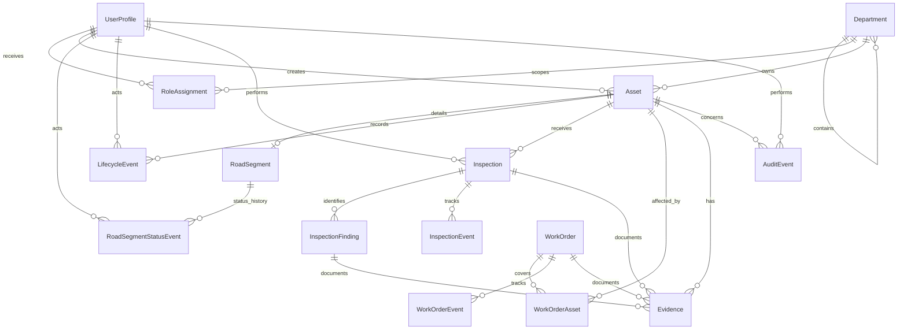

# Database Schema Review

## Status

The current Prisma schema is a **valid, road-first prototype foundation**. `prisma validate` passes after the agreed schema updates. It is not yet complete for the full product or the entire asset lifecycle. The project owner reports that migrations 001–004 were applied; this workspace has not independently verified the live database. Migration 005 for runtime-role RLS remains pending.

The schema defines one category (`ROAD_SEGMENT`), a shared lifecycle stage and asset location, road-specific workflow status/history, and shared records for accounts/department scope, inspections, work orders, evidence metadata, and event history. Inspection event details now preserve a snapshot of each submitted payload so corrections do not erase prior findings. Transfer and decommission are present in event vocabulary; their operational workflows are not implemented. It deliberately does not define a generic workflow builder or future asset-category tables.

## Current relationship map

`Evidence` requires an asset link and may point to at most one inspection, finding, or work order. The file itself is not stored in PostgreSQL; no storage provider is implemented yet.

## Current model inventory

| Area | Current model(s) | Review note |
|---|---|---|
| Organization and access | `Department`, `UserProfile`, `RoleAssignment` | One string jurisdiction field and optional department parent; role scope is exact-department in the prototype. |
| Asset register | `Asset`, `RoadSegment` | Shared asset has optional paired latitude/longitude representative coordinates; road detail retains optional start/end coordinates and has its own workflow status. |
| Lifecycle / audit | `LifecycleEvent`, `InspectionEvent`, `WorkOrderEvent`, `AuditEvent` | Event rows have actor and DB default timestamp, but database schema alone does not guarantee append-only writes or conditional reason rules. |
| Condition | `Inspection`, `InspectionFinding`, `ConditionRating` | Findings are free-form categories with a severity enum; no approved inspection template or official rating scale exists. |
| Maintenance | `WorkOrder`, `WorkOrderAsset` | Supports multiple linked assets, although first slice is road-focused; no approval policy model. |
| Evidence | `Evidence` | Metadata and storage key only; visibility is a controlled enum, but storage, classification policy, retention, upload/download authorization remain open. |

## Gaps to resolve before calling the product schema complete

1. **Additional categories:** only `ROAD_SEGMENT` is in the enum today. Add category-specific models and state vocabularies sequentially, after the road slice.
2. **Lifecycle coverage:** shared stage and transfer/decommission event vocabulary now exist, but planning/acquisition, ownership/location reassignment, improvement, transfer acceptance, and decommission checks do not yet have complete operations.
3. **Role provisioning:** `INSPECTOR` is distinct; its independence is a prototype assumption, not implemented conflict-of-interest enforcement. `ADMIN` is defined but is not provisioned by the demo seed. `PLANNER` is the current read-only demo role.
4. **History guarantees:** Prisma models do not prevent an application/database operator from editing or deleting events. Reason-required-on-backward/terminal rules are not database constraints. Server-side operations must enforce these and the application should test them when implemented; stronger DB permissions/triggers can be considered if needed.
5. **Scope consistency:** foreign keys ensure referenced rows exist, but do not guarantee that an evidence row, inspector, assignee, work order, and asset all belong to the same department or authorized scope.
6. **Operational policies:** official asset identifiers, geometry standards, condition scales, approvals, work types, cost handling, retention, and role combinations are still open questions in `Decision.md`.

## Decisions incorporated from review

- Shared lifecycle stage is used for cross-category reporting; road workflow status and its event history are category-specific.
- The first feature slice remains road-only; other category models/workflows will be added sequentially.
- `INSPECTOR` remains distinct and is intended to be independent of work request/approval roles; policy enforcement is deferred.
- Transfer and decommission event types are included; detailed approval workflows are deferred.
- Work order costs assume one currency for the synthetic prototype; `EvidenceVisibility` is a controlled technical enum, not a complete information-classification policy.
- Shared asset coordinates are nullable for draft/planned records and constrained to be a valid pair/range; requiring them before activation remains an unimplemented prototype rule.

## Verification performed

- `npx prisma validate` succeeded using placeholder local connection URLs; this checks Prisma schema validity, not a live database connection.
- The initial migration and follow-up migrations exist under `prisma/migrations/`; they include manual SQL checks for road measurements, evidence size/links, shared asset coordinates, and inspection payload snapshots.
- The lifecycle migration maps existing asset/road status values into the shared stage and road-specific workflow state. It checks that legacy evidence visibility values fit the new enum instead of silently recategorizing unknown values. Review these mappings against actual legacy data before applying to a populated database.
- At the time of the original review, the three migrations had not yet been applied. The project owner later reported that all three applied successfully. This workspace could not independently connect to verify them; see the dated database security follow-up below.
- The application now has code for the road register, review/return/correction loop, findings capture and inspection correction/resubmission, assigned work orders, completion review, and work-order lifecycle-stage restoration.
- After the code-review remediation pass, Biome lint, TypeScript typecheck, Prisma client generation, and Prisma schema validation succeeded. Twelve tests cover authorization scope, self-review prevention, work-order transitions/reasons, lifecycle-stage restoration, transaction identity ordering, and static RLS migration coverage.
- Database-backed action flows and RLS policies have not been integration-tested with the restricted runtime role. A prior production build reached final trace collection but terminated with an out-of-memory error. The road workflow and row isolation therefore still need runtime verification.

## Suggested next step

The project owner reported applying migration 004 and verified all 15 application tables in `pravi`. Review and apply migration 005 to the intended development database, provision the restricted runtime login, switch `DATABASE_URL`, then run `npm run db:inspect-security` and complete role-isolation smoke tests. Keep unresolved government processes labeled as prototype assumptions.

## Database security follow-up (2026-09-28)

- The project owner reports migrations 001–004 applied successfully and supplied diagnostic output showing 15 tables in `pravi`, migration history in `public`, and a `postgres` runtime role with `BYPASSRLS`.
- Migration 005 is prepared to add a non-login `pravi_app` role, least-privilege grants, transaction-context helper functions, and forced department-scoped RLS on all 15 models. Its first run failed during shadow validation because it tried to alter role attributes. The migration has been revised to create with safe defaults and avoid `ALTER ROLE`; it still has not been applied to the live database.
- After migration 005, provision a password for `pravi_app` out of band, use that role for `DATABASE_URL`, and keep `DIRECT_URL` privileged for migrations and explicit administrative seeding. Confirm the diagnostic shows `bypassRls: false` and all 15 tables have RLS enabled/forced.
- The app sets a verified Clerk user ID transaction-locally before protected queries; tests cover context ordering and static policy coverage. Database-backed allow/deny tests still need to run with the restricted runtime connection before claiming effective row isolation.
